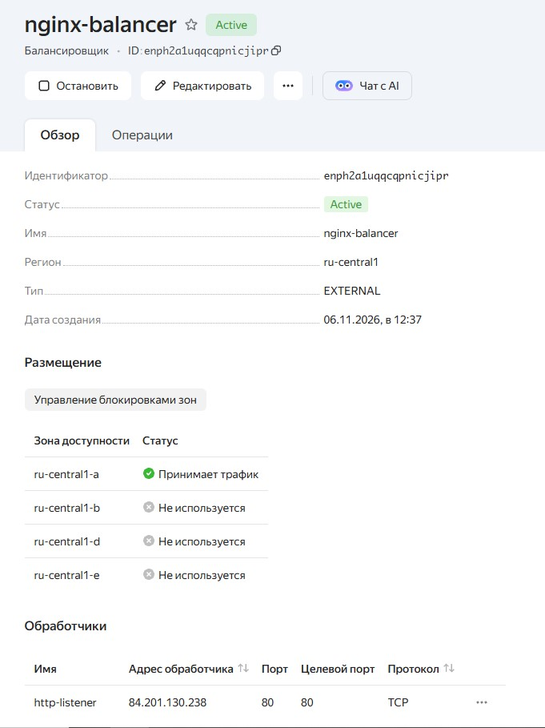
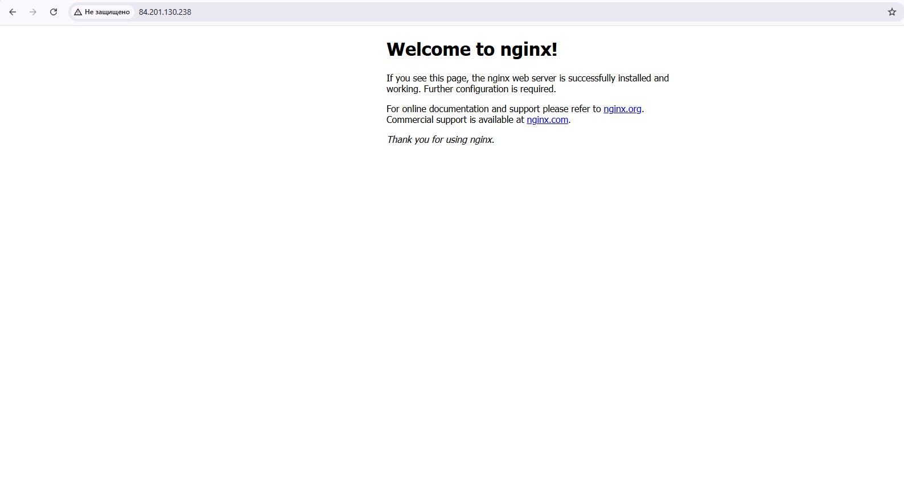
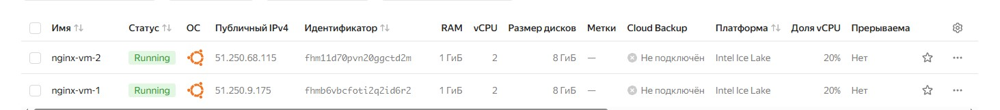

# Домашнее задание к занятию "`Название занятия`" - `Фамилия и имя студента`


### Инструкция по выполнению домашнего задания

   1. Сделайте `fork` данного репозитория к себе в Github и переименуйте его по названию или номеру занятия, например, https://github.com/имя-вашего-репозитория/git-hw или  https://github.com/имя-вашего-репозитория/7-1-ansible-hw).
   2. Выполните клонирование данного репозитория к себе на ПК с помощью команды `git clone`.
   3. Выполните домашнее задание и заполните у себя локально этот файл README.md:
      - впишите вверху название занятия и вашу фамилию и имя
      - в каждом задании добавьте решение в требуемом виде (текст/код/скриншоты/ссылка)
      - для корректного добавления скриншотов воспользуйтесь [инструкцией "Как вставить скриншот в шаблон с решением](https://github.com/netology-code/sys-pattern-homework/blob/main/screen-instruction.md)
      - при оформлении используйте возможности языка разметки md (коротко об этом можно посмотреть в [инструкции  по MarkDown](https://github.com/netology-code/sys-pattern-homework/blob/main/md-instruction.md))
   4. После завершения работы над домашним заданием сделайте коммит (`git commit -m "comment"`) и отправьте его на Github (`git push origin`);
   5. В личном кабинете прикрепите и отправьте ссылку на решение в виде md-файла в вашем Github.
   6. Любые вопросы по выполнению заданий спрашивайте в разделе “Вопросы по заданию” в личном кабинете.
   
Желаем успехов в выполнении домашнего задания!
   
### Дополнительные материалы, которые могут быть полезны для выполнения задания

1. [Руководство по оформлению Markdown файлов](https://gist.github.com/Jekins/2bf2d0638163f1294637#Code)

---

### Задание 1

`При создании инфраструктуры был использован Terraform. Настроен сетевой балансировщик, целевая группа и две ВМ с Nginx, созданные с помощью аргумента count. Установка Nginx производилась через cloud-init.`

1. `Инициализация Terraform и настройка провайдера Yandex Cloud`
2. `Создание VPC сети и подсети для виртуальных машин.`
3. `Создание группы безопасности (Security Group) с разрешенными портами 80 (HTTP) и 22 (SSH).`
4. `Создание двух идентичных ВМ с Ubuntu и установкой Nginx.`
5. `Создание целевой группы (Target Group) и сетевого балансировщика (NLB) с HTTP-проверкой.`
6. `Проверка статуса балансировщика и работоспособности Nginx.`

```
Поле для вставки кода...
terraform {
  required_providers {
    yandex = {
      source = "yandex-cloud/yandex"
    }
  }
  required_version = ">= 0.13"
}

# === Изменения для Windows ===
variable "folder_id" {
  type    = string
  default = "b1gmsg6npalq1lc3v1r6" 
}

variable "ssh_key_path" {
  type    = string
  default = "C:/Users/d.biriukov.MCM/.ssh/id_ed25519.pub"
}

provider "yandex" {
  folder_id = var.folder_id
  zone      = "ru-central1-a"
}

# Сеть и подсеть
resource "yandex_vpc_network" "net" {
  name = "balancer-net"
}

resource "yandex_vpc_subnet" "subnet" {
  name           = "balancer-subnet"
  zone           = "ru-central1-a"
  network_id     = yandex_vpc_network.net.id
  v4_cidr_blocks = ["192.168.10.0/24"]
}

# Группа безопасности: разрешаем HTTP (80) и SSH (22)
resource "yandex_vpc_security_group" "sg" {
  name       = "balancer-sg"
  network_id = yandex_vpc_network.net.id

  ingress {
    protocol       = "TCP"
    description    = "HTTP"
    v4_cidr_blocks = ["0.0.0.0/0"]
    port           = 80
  }

  ingress {
    protocol       = "TCP"
    description    = "SSH"
    v4_cidr_blocks = ["0.0.0.0/0"]
    port           = 22
  }

  egress {
    protocol       = "ANY"
    description    = "any"
    v4_cidr_blocks = ["0.0.0.0/0"]
    from_port      = 0
    to_port        = 65535
  }
}

# Создание 2 ВМ с помощью count
resource "yandex_compute_instance" "vm" {
  count = 2
  name  = "nginx-vm-${count.index + 1}"
  platform_id = "standard-v3"
  allow_stopping_for_update = true

  resources {
    cores  = 2
    memory = 1
    core_fraction = 20
  }

  boot_disk {
    initialize_params {
      image_id = "fd8li2lvvfc6bdj4c787" # Ubuntu 22.04 LTS
    }
  }

  network_interface {
    subnet_id          = yandex_vpc_subnet.subnet.id
    security_group_ids = [yandex_vpc_security_group.sg.id]
    nat                = true
  }

  metadata = {
    ssh-keys  = "ubuntu:${file(var.ssh_key_path)}"
    user-data = <<EOF
#cloud-config
package_update: true
packages:
  - nginx
runcmd:
  - apt-get remove --purge apache2 -y
  - systemctl stop apache2 || true
  - systemctl disable apache2 || true
  - systemctl start nginx
  - systemctl enable nginx
EOF
  }
}

# Целевая группа
resource "yandex_lb_target_group" "tg" {
  name = "nginx-target-group"

  dynamic "target" {
    for_each = yandex_compute_instance.vm
    content {
      subnet_id = yandex_vpc_subnet.subnet.id
      address   = target.value.network_interface.0.ip_address
    }
  }
}

# Сетевой балансировщик нагрузки (NLB)
resource "yandex_lb_network_load_balancer" "nlb" {
  name = "nginx-balancer"

  listener {
    name = "http-listener"
    port = 80
    external_address_spec {
      ip_version = "ipv4"
    }
  }

  attached_target_group {
    target_group_id = yandex_lb_target_group.tg.id

    healthcheck {
      name = "http-healthcheck"
      http_options {
        port = 80
        path = "/"
      }
      healthy_threshold   = 2
      unhealthy_threshold = 2
      interval            = 2
      timeout             = 1
    }
  }
}

output "balancer_ip" {
  value = [
    for listener in yandex_lb_network_load_balancer.nlb.listener :
    [
      for spec in listener.external_address_spec : spec.address
    ][0]
  ][0]
}


```

`При необходимости прикрепитe сюда скриншоты

`

`

`

`


---